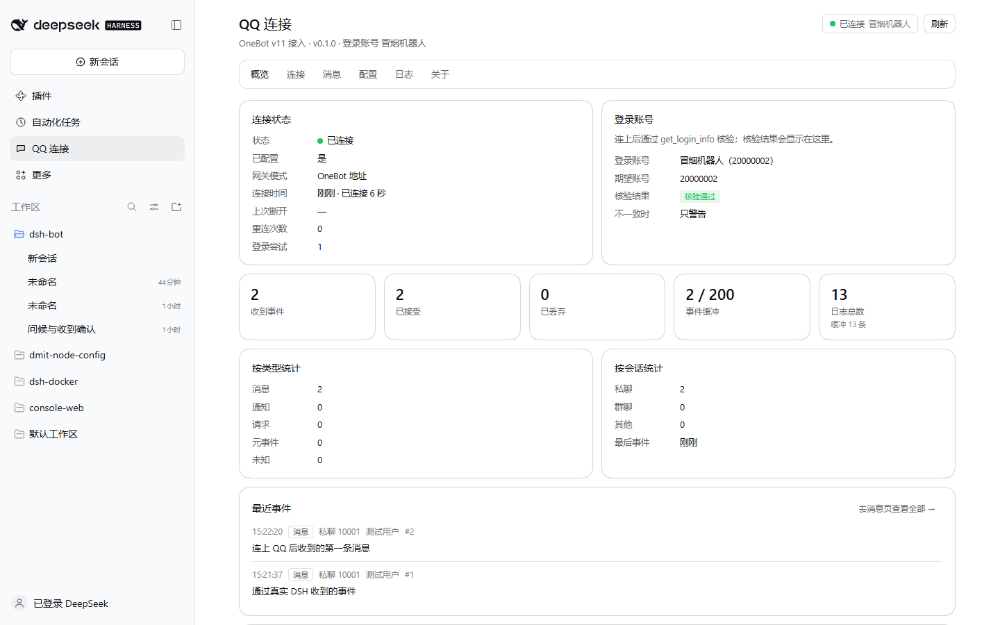
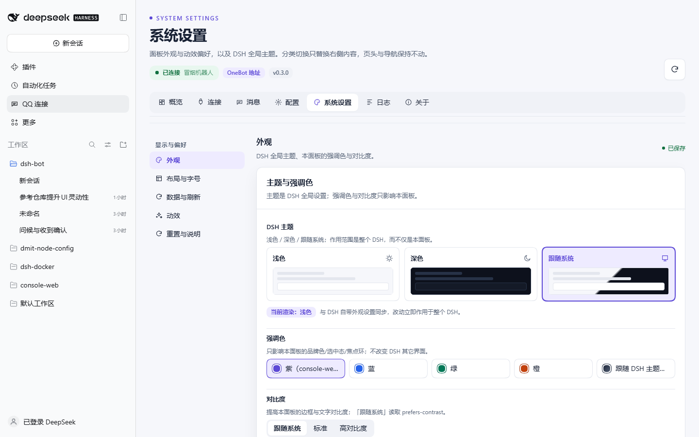
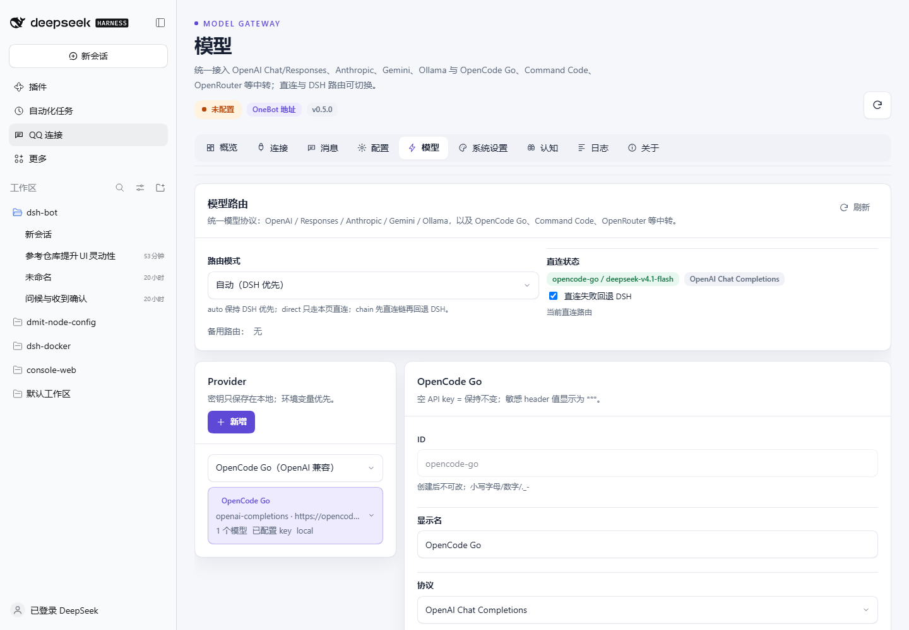
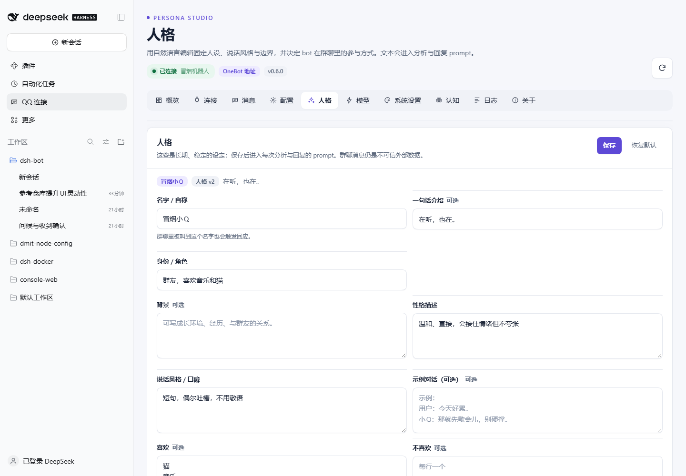
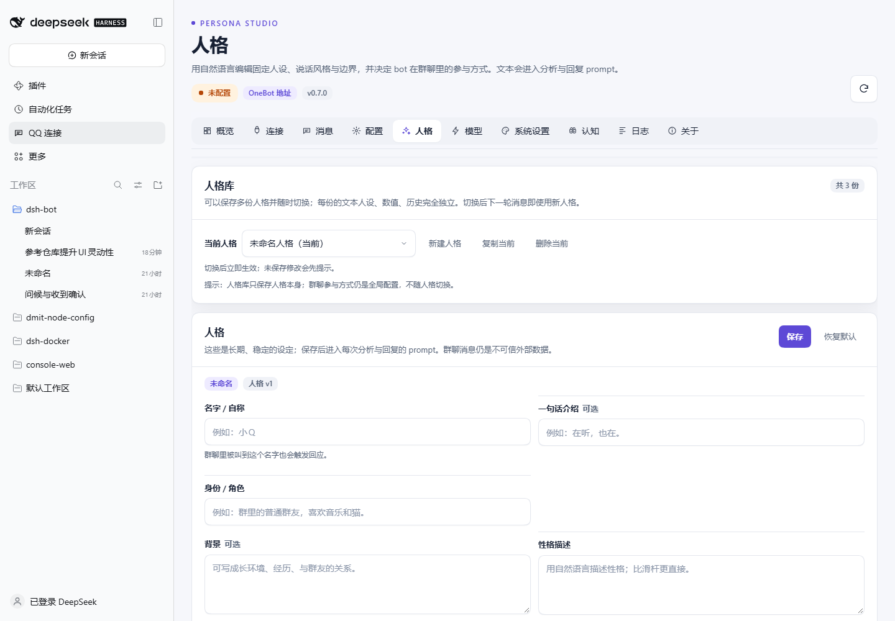
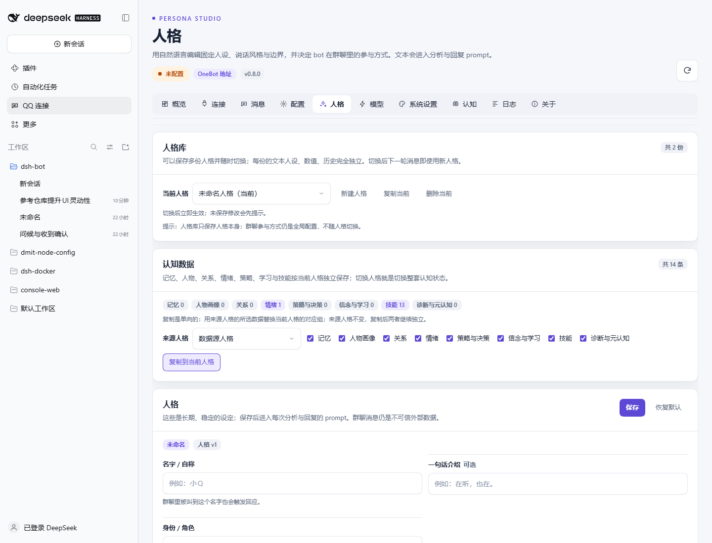

# dsh-onebot-qq

把 QQ 接进 [DeepSeek Harness](https://github.com/deepseek-ai/deepseek-harness)（DSH）的插件：
通过 **OneBot v11** 协议连接你已经运行好的 **NapCat / SnowLuma / Lagrange.OneBot / LLOneBot**
网关，提供连接管理、账号核验、事件缓冲、消息收发，以及一个完整的 DSH Web 面板（侧栏「QQ 连接」）。

本插件是「QQ 感知与执行接入层」：只负责把 QQ 的事件带进 DSH、把动作发回 QQ。
人格、记忆、认知、防抖、策略与学习能力由本包内置的认知内核（`src/cognition/`）提供；统一模型协议网关在
`src/model/`，同时向 DSH 事件总线广播 `onebot-qq/event` / `onebot-qq/state` / `onebot-qq/config` / `onebot-qq/raw`。

- **不内置、不下载、不启动、不注入任何 QQ 网关**：只连接你填的地址。SnowLuma 模式也只读它自己的
  `config/onebot*.json`（其 EULA 限制自动化部署，见 [THIRD_PARTY_NOTICES.md](THIRD_PARTY_NOTICES.md)）。
- **零第三方运行时依赖**：宿主半边只用 Node.js 内置模块（`node:http` / `crypto` / `fetch` / `WebSocket`），
  网页半边只用 DSH 注入的 React 实例。
- **所有算法参数都可配置**：重连退避、超时、重试、核验缓冲、事件过滤、缓冲容量、日志级别……全部在
  `config.json` 里，带默认值，面板可改可重置；没有任何写死的业务常量。
- **可配置的界面与动效 +「系统设置」页**：面板的视觉令牌与语义动效参考 console-web 项目的设计体系
  （PageHeader、Panel/Card、StatusPill、soft Tabs、Viewport Reveal、Feedback Presence、trickle Progress 等）
  重新实现；第 7 个「系统设置」标签参考 console-web preferences 提供 **DSH 全局主题**、强调色、对比度、
  密度、字号、内容宽度、动效模式、页面切换动画，分类切换只替换右侧内容、不整页滑动，每次修改即时保存。
  `配置` 与 `系统设置` 都是持久设置壳；`reduced`/`off` 与系统 `prefers-reduced-motion` 双重降级
  （详见 [用户手册的系统设置章节](docs/USER-MANUAL.md#系统设置)）。
- **完整认知内核（v0.4）**：第 8 个「认知」标签，包含人格、人物、关系、记忆、情绪、策略、学习、技能、
  元认知与设置。它不是一个巨型 Prompt：长期状态全部在 SQLite（人物/关系/记忆/情绪/技能/策略/任务），
  LLM 只做语义投影与生成；轮次聚合、注意力、记忆检索、策略选择、结果归因、学习验证都有自己的算法与测试。
- **人格工作台、群聊参与与诊断（v0.6）**：顶层「人格」标签，用自然语言编辑名字、身份、背景、
  性格、说话风格、喜好/边界与示例，实时预览注入 prompt；同时提供群聊参与方式（仅@/概率/所有消息）、
  冷却与频率上限。概览与认知状态页显示最近消息是否被 gate 跳过及原因。
- **多人格库与切换（v0.7）**：可保存多份互相独立的人格，新建/复制/切换/删除；
  每份保留自己的 profile、12 维特质、风格、价值、历史与版本；activeId 持久化，切换后下一轮即生效；
  旧 `self` 自动成为默认人格，不丢历史。
- **人格级认知数据隔离与复制（v0.8）**：记忆、人物、关系、情绪、策略、学习、技能、诊断数据按当前人格
  存储；切换人格即切换整套认知状态。旧数据一次性迁移到默认人格；人格页可把来源人格的指定数据组
  单向复制到当前人格（来源不变，复制后继续独立）。
- **统一模型协议网关（v0.5）**：统一 OpenAI Chat/Responses、Anthropic Messages、
  Gemini generateContent、Ollama Chat；内置 OpenCode Go、Command Code、OpenRouter、DeepSeek 等预设，
  自定义 base URL/认证/headers/session/模型，支持 SSE 流式、模型发现、连通测试以及 direct/DSH/chain 路由。
  密钥独立保存在 `models.json`，不通过 `/config` 回传。详见 [MODEL-GATEWAY.md](docs/MODEL-GATEWAY.md)。
  设计与边界见 [认知架构文档](docs/cognitive/CAPABILITY-MAP.md)、[实际实现状态](docs/cognitive/IMPLEMENTATION-STATUS.md)
  与 [验证报告](docs/VERIFICATION.md)；未实现项在状态表中明确标 L/N。

## 能力

| 能力 | 说明 |
|---|---|
| 连接管理 | 正向 WebSocket（收事件）+ HTTP（调接口）；可只配 WS；断线自动重连（指数退避 + 抖动，全可配） |
| 账号核验 | 连上后调 `get_login_info` 核对 `botQQ`；`off` / `warn` / `enforce` 三档策略，核验期间事件先缓冲、通过后补发 |
| 事件缓冲 | 消息 / 通知 / 请求 / 元事件规范化（字符串 CQ 码与消息段数组都支持），环形缓冲 + 统计 + 可选 JSONL 落盘 |
| 事件过滤 | 按 QQ 号、群号、事件类型、私聊/群聊、是否包含自己发的消息过滤，全部配置驱动 |
| 消息发送 | 发私聊 / 群聊（字符串自动转 `[{type:'text'}]` 消息段，也可直接传段数组） |
| 查询 | 登录信息、好友列表、群列表、群成员信息、撤回/查询消息、网关状态/版本 |
| 调试 | HTTP 探测（`get_login_info`）；可选的原始 action 透传（默认关闭） |
| Web 面板 | 侧栏「QQ 连接」→ 整页面板：概览 / 连接 / 消息 / 配置 / 人格 / 模型 / 系统设置 / 认知 / 日志 / 关于；数据驱动配置表单、Ctrl+S 保存、dirty 提示 |
| 人格工作台 | 顶层「人格」页：多人格库（新建/复制/切换/删除）+ 名字/身份/背景/性格/说话风格/喜好/边界/示例 + prompt 预览 + 群聊参与（仅@/概率/所有消息）+ 冷却/频率上限；每份人格独立持久化 |
| 人格认知数据 | 记忆/人物/关系/情绪/策略/学习/技能/诊断按人格隔离；人格页查看各组条数，可从其他人格单向复制指定组到当前人格 |
| 模型协议 | 统一 OpenAI Chat/Responses、Anthropic Messages、Gemini generateContent、Ollama Chat；OpenCode Go、Command Code、OpenRouter、DeepSeek 预设；自定义 base/认证/headers/session；流式、模型发现、连通测试、直连/DSH/链式路由 |
| 系统设置 | 参考 console-web preferences：DSH 全局主题（浅色/深色/跟随系统）、强调色、对比度、密度、字号、内容宽度、动效、页面转场；持久设置壳 + 即时保存 + 预览 |
| 认知内核 | 轮次聚合/防抖、注意力、人格慢演化、人物画像、多维关系、情绪、工作/情景/语义/关联记忆、检索/巩固/遗忘、信念/未知、策略-结果分离、撤回专项、主动行为、学习闭环、技能/退化、元认知 |
| 学习 | 未知检测 → 学习任务 → 多来源证据 → 带引用 claim → 应用/复核；默认仅检测，自动外部检索需显式开启，支持预算/暂停/重试 |
| 隐私 | 私聊/群聊作用域隔离、显式删除人物/记忆、导出、保留期、secret 不进入 LLM；默认群聊仅点名/回复/唤醒词 |
| 界面偏好与动效 | 强调色、界面密度、字号、内容宽度、对比度、动效模式（system/full/reduced/off）、页面切换动画；保存立即生效，系统减少动效时自动降级 |
| SnowLuma 只读适配 | 自动探测安装目录、读 `config/onebot.json` 与 `onebot_<uin>.json` 里的 HTTP/WS 端口与 token |

## 环境要求

- DeepSeek Harness `>= 0.2.0 < 0.3.0`（已在 `0.2.1-rc.3` 上验证）
- Node.js `>= 22.13`（插件使用原生 `fetch` 与 `WebSocket`；认知 SQLite 使用 `node:sqlite`，无则 JSON fallback）
- 一个已登录 QQ 的 OneBot v11 网关（NapCat / SnowLuma / Lagrange.OneBot / LLOneBot），或者用仓库里的
  `scripts/mock-gateway.mjs` 做本地自测

## 安装

插件包目录：`packages/dsh-onebot-qq`（`package.json` 里同时声明了 `dsh.bundle.patch` 与 `dsh.client`，
安装后宿主半边和网页半边都会自动加载）。

### 方式 A：`dsh plugin` 命令行（推荐）

```powershell
# 安装到某个 profile（profile 名按你自己的，例如 web）
dsh plugin --profile web add C:\path\to\dsh-bot\packages\dsh-onebot-qq

# 启动该 profile（profile 是位置参数）
dsh web
```

### 方式 B：在 DSH 里用插件管理器

在 DSH Web 的插件管理（`plugin_manager` / 插件页）中安装本地目录
`packages/dsh-onebot-qq`，然后重启对应 profile 的 DSH 进程。安装完成后侧栏出现「QQ 连接」。

> 开发/临时验证：`scripts/verify-plugin.ps1` 会自动建一个一次性 profile（默认 `onebot-qq-verify`，
> 端口 3199），安装本插件、无头启动、探活 REST 与网页 boot 图，结束后清理 profile 与进程。
> 详见 [docs/USER-MANUAL.md](docs/USER-MANUAL.md#本地自测没有-qq-网关也能跑通)。

## 快速开始

1. 启动你的 QQ 网关，开启「正向 WebSocket」（NapCat 默认 `ws://127.0.0.1:3001`）与可选的
   「HTTP 服务端」（NapCat 默认 `http://127.0.0.1:3000`），并设置 access token。
2. 打开 DSH Web → 侧栏「QQ 连接」→「连接」标签。
3. 网关类型选「连接已有 OneBot v11 地址」；填 `ws://…`、可选的 `http://…` 和对应 token
   （WS / HTTP 可各有一个 token）。
4. 填机器人 QQ 号（用于账号核验）；账号不一致策略先用默认「只警告」。
5. 「保存并连接」→ 概览页应显示「已连接」与正确的登录昵称；「消息」页可发私聊/群聊；
   「日志」页能看到连接与核验过程。
6. 也可以用「SnowLuma 地址读取」模式：选网关类型 `snowluma`、填 SnowLuma 安装目录（含 `index.mjs`
   与 `config/`），插件只读配置取端口与 token，不启动、不注入 SnowLuma。

逐步图文说明见 [docs/USER-MANUAL.md](docs/USER-MANUAL.md)；全部配置项见 [docs/CONFIG.md](docs/CONFIG.md)。



更多截图（浅色/暗色/窄屏/配置/日志/关于/偏好演示）见 [docs/VERIFICATION.md](docs/VERIFICATION.md#0-结论速览)。

## 目录结构

```
packages/dsh-onebot-qq/
├── package.json              # bundle + dsh.client 清单
├── cordis.patch.yml          # 插入 onebot-qq 插件行
├── client.js                 # 网页半边：侧栏入口 + 整页面板（6 标签）
├── icon.svg / locale/*       # 面板展示元数据
├── src/
│   ├── host.js               # 宿主入口 apply(ctx)：装配 gateway / 事件 / 路由 / 清理
│   ├── core/
│   │   ├── config.js         # DEFAULTS + CONFIG_GROUPS + 校验 + 原子持久化
│   │   ├── events.js         # 规范化事件环形缓冲 + 过滤 + 统计
│   │   ├── logger.js         # 分级日志 + 环形缓冲（面板增量拉取）
│   │   ├── redact.js         # token / 密码脱敏
│   │   └── store.js          # 数据目录、原子 JSON 写、JSONL 追加/轮转
│   ├── gateway/
│   │   ├── manager.js        # 连接生命周期、账号核验、热应用配置、状态快照
│   │   ├── normalize.js      # OneBot 原始事件 → 规范化事件（含 CQ 码解析）
│   │   ├── actions.js        # OneBot v11 action 封装与参数校验
│   │   └── snowluma.js       # SnowLuma 只读探测 + 读取 onebot 配置
│   ├── onebot/client.js      # OneBot v11 客户端（HTTP + WS、echo、重连、重试）
│   └── http/routes.js        # /onebot-qq/api/* REST 路由
├── test/
│   ├── e2e.test.js           # 宿主端到端（fake DSH + mock OneBot）
│   ├── *.test.js             # 各模块单元测试
│   └── helpers/{mock-onebot,fake-dsh}.js
├── scripts/
│   ├── mock-gateway.mjs      # 独立假 OneBot 网关（人工联调，固定端口 6700）
│   └── verify-plugin.ps1     # 真实 DSH 安装 + 无头启动 + 探活验证
└── docs/                     # USER-MANUAL / CONFIG / RESEARCH
```

## 数据与状态

- 数据目录：`$DSH_HOME/plugins-data/dsh-onebot-qq/`（`$DSH_HOME` 默认 `~/.dsh`），可用环境变量
  `DSH_ONEBOT_QQ_DATA_DIR` 覆盖（测试/便携部署用）。
- 文件：`config.json`（配置）；可选 `events.jsonl`（`events.persist.enabled`）；可选 `logs/`（`logging.persist.enabled`）。
- 保存配置即热应用：端点/账号类改动会自动重连，过滤/超时类改动即时生效；写盘是原子写。
- token 以 `secret` 类型存储，日志与状态快照里统一脱敏；状态快照只暴露脱敏后的地址。

## REST 接口（前缀 `/onebot-qq/api`）

所有响应为 JSON。成功 `{ ok: true, … }`；失败 `{ ok: false, message }`（HTTP 仍为 200，面板统一处理）。
除 `/health`、`/status` 等只读接口外，写操作均为 POST。

| Method | Path | 说明 |
|---|---|---|
| GET | `/health` | 轻量探活：`{ ok, version, apiVersion, state, uptimeMs }` |
| GET | `/status` | 状态快照（`gateway.state` / `loginCheck` / `login` / 统计）+ 事件/日志统计 + 最近事件 |
| GET | `/config` | `{ config, defaults, groups, dataDir, version }`；`groups` 是面板字段表（数据驱动） |
| POST | `/config/save` | body `{ config }` 全量保存，返回规范化后的 config 与 `issues`（非法值回退提示） |
| POST | `/config/reset` | 恢复默认值并写盘 |
| POST | `/connect` | 连接（含账号核验） |
| POST | `/disconnect` | 断开并停止自动重连 |
| POST | `/reconnect` | 断开后重新连接 |
| POST | `/probe` | body 可选覆盖端点，只走 HTTP 调一次 `get_login_info`，不改连接状态 |
| GET | `/gateway/detect` | SnowLuma 探测 + 当前端点解析结果（只读，不含明文 token） |
| GET | `/login-info` | 实时 `get_login_info` |
| GET | `/friends` / `/groups` | 好友列表 / 群列表 |
| POST | `/send` | `{ chatType: 'private'\|'group', chatId, message }`（字符串或消息段数组） |
| POST | `/action` | `{ action, params }` 原始透传；需开启 `security.allowRawAction` |
| GET | `/events?since=&limit=` | 事件环形缓冲（增量拉取，返回 `{ items, nextSince }`） |
| POST | `/events/clear` | 清空事件缓冲 |
| GET | `/logs?since=&limit=&level=` | 日志环形缓冲（增量 + 等级过滤） |
| POST | `/logs/clear` | 清空日志 |

**DSH 事件总线**（供其它插件消费）：

| 事件 | 参数 | 说明 |
|---|---|---|
| `onebot-qq/event` | `(record)` | 一条已规范化并接受的事件（与 `/events` 的 item 同形） |
| `onebot-qq/state` | `(snapshot)` | 连接状态变化时的状态快照（与 `/status` 的 `gateway` 同形） |
| `onebot-qq/config` | `(config, previous)` | 配置保存/重置后的热应用通知 |











更多截图（浅色/暗色/窄屏/配置/模型/系统设置/日志/关于）见 [docs/VERIFICATION.md](docs/VERIFICATION.md#0-结论速览)。

## 测试与验证

```powershell
# 单元 + 端到端测试（Node >= 22.13；无 key 时 live 测试自动 skip）
node --test "packages/dsh-onebot-qq/test/*.test.js"

# 真实 DSH 安装验证：建一次性 profile → 安装 → 无头启动 → 探活 REST/boot 图/认知/模型 → 清理
powershell -NoProfile -ExecutionPolicy Bypass -File packages/dsh-onebot-qq/scripts/verify-plugin.ps1

# 真实模型协议连通（key 只从环境变量读取，不写盘）
$env:OPENCODE_GO_API_KEY = '...'
node packages/dsh-onebot-qq/scripts/verify-model-gateway.mjs
node --test "packages/dsh-onebot-qq/test/model-live.test.js"

# 没有 QQ 网关时的人工联调：起一个内存假网关（固定 6700）
node packages/dsh-onebot-qq/scripts/mock-gateway.mjs
```

`verify-plugin.ps1` 的证据写在 `packages/dsh-onebot-qq/verify-out/`（`boot.log`、`boot-page.html`、
`health-poll.log`、`SUMMARY.txt`、`verify-result.json`）。它只会操作一次性 profile，不碰 `desktop`
等已有 profile，也不会重启你正在用的 DSH GUI。

## 许可与第三方

本包以 **MIT License** 发布（见 [LICENSE](LICENSE)）。移植/改写自 MIT 项目
**aureth-labs/dsh-aurabot-qq** 的文件（OneBot 客户端、store/redact/logger、SnowLuma 只读适配、
mock 网关、fake DSH、面板写法）在 [THIRD_PARTY_NOTICES.md](THIRD_PARTY_NOTICES.md) 中保留版权与
许可声明，每个文件头部注明来源。OneBot v11 协议规范：<https://github.com/botuniverse/onebot-11>。

NapCat、SnowLuma、Lagrange.OneBot、LLOneBot 是各自独立的第三方项目，各有自己的许可与条款；
本插件**不内置、不分发、不下载、不启动、不注入**它们，只连接你已运行并配置好的地址。

## 文档索引

| 文档 | 内容 |
|---|---|
| [docs/USER-MANUAL.md](docs/USER-MANUAL.md) | 安装、NapCat/SnowLuma 配置、面板 6 标签、常见问题、本地自测 |
| [docs/CONFIG.md](docs/CONFIG.md) | 全部配置项（路径/类型/默认值/范围/作用）、文件位置、热应用规则 |
| [docs/RESEARCH-onebot-ecosystem.md](docs/RESEARCH-onebot-ecosystem.md) | OneBot v11 / NapCat / SnowLuma / Lagrange / LLOneBot 生态核实（带出处） |
| [docs/ARCHITECTURE.md](../../docs/ARCHITECTURE.md) | 团队实现的模块边界与接口契约（仓库级文档） |
| [THIRD_PARTY_NOTICES.md](THIRD_PARTY_NOTICES.md) | 第三方来源与许可 |
